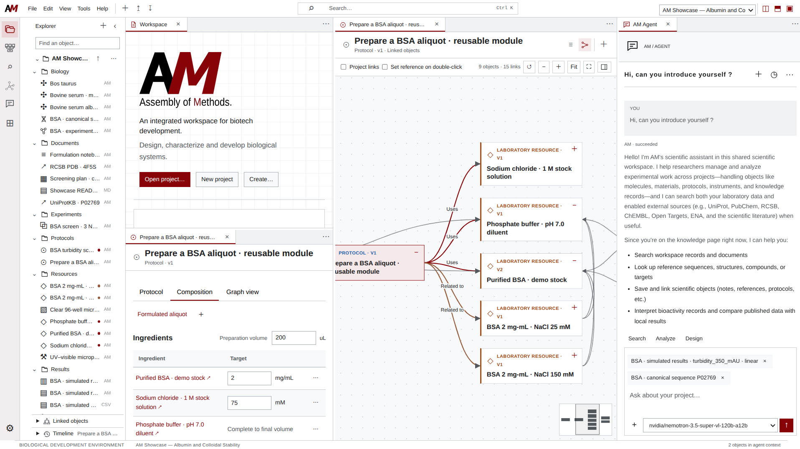
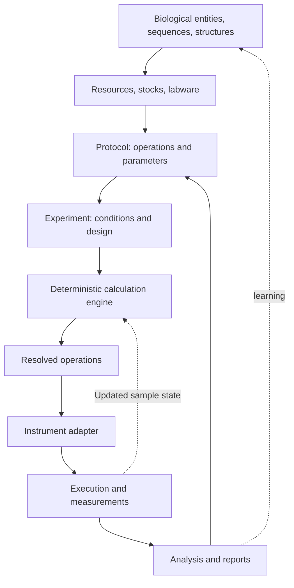
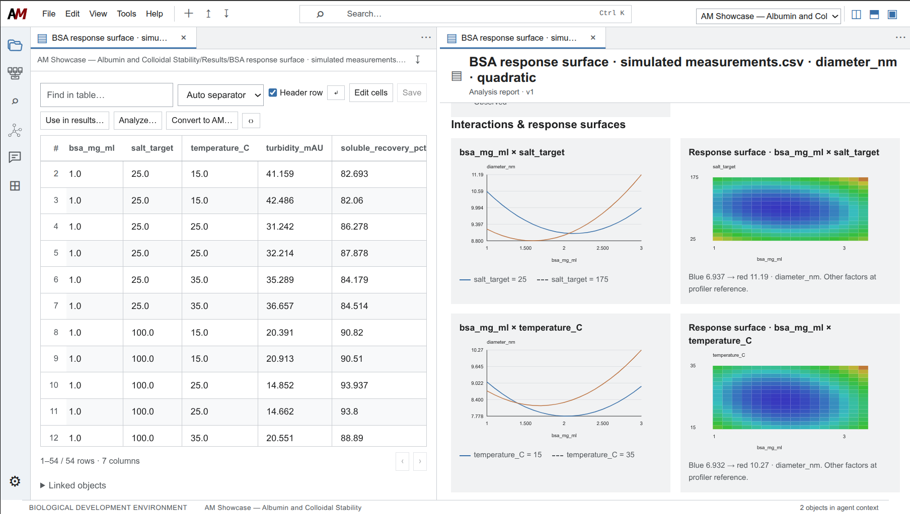
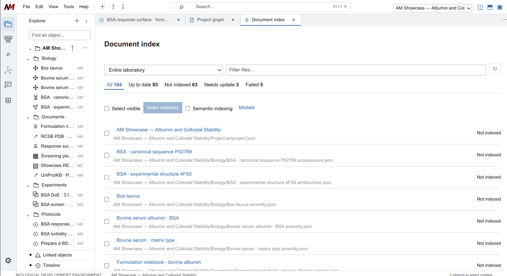
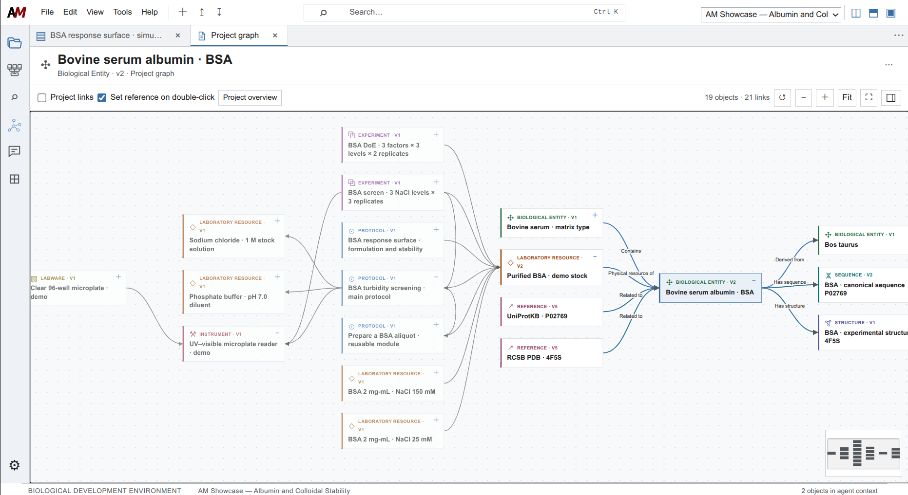
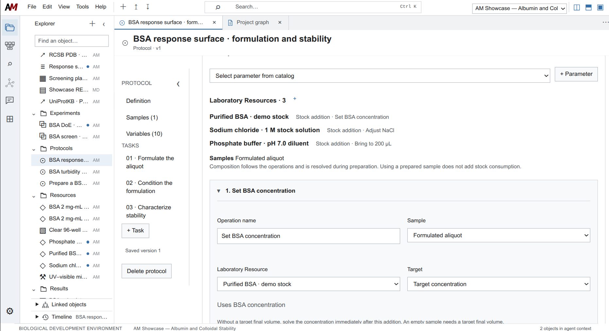
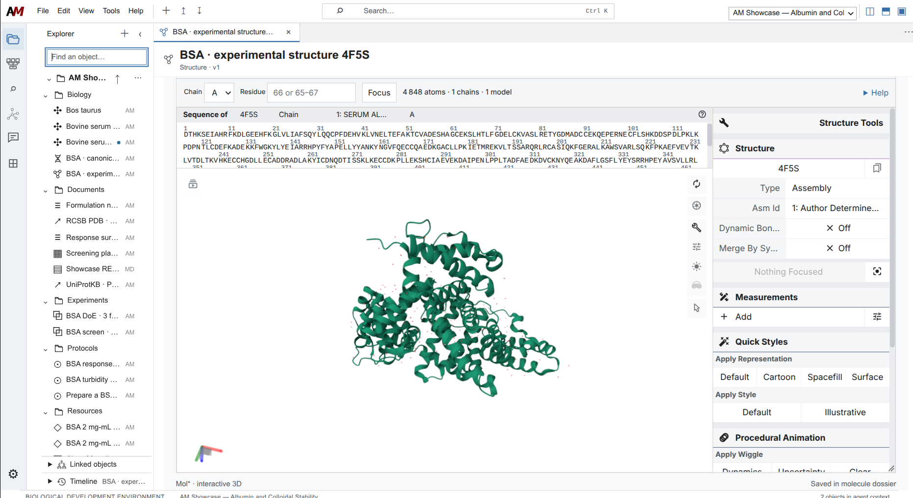

# AM (Assembly of Methods)

**An integrated workspace for biotech development.**

Design, characterize and develop biological systems.

> The main window showing the home, the formulation builder, the graph of linked objects and the AI agent.

AM is a software project I've been working on to bring the different parts of experimental biotechnology into a single workspace. It takes inspiration from integrated development environments used in programming, where files, tools, dependencies and execution are accessible from the same place. AM stands for Assembly of Methods. The name reflects the basic idea that scientific methods, resources, calculations and instrument adapters should be composable, instead of every new workflow being rebuilt as a separate software project

In AM, biological entities, laboratory resources, protocols, experiments, instruments and results are represented as structured objects that can reference one another. A protocol can be used to calculate an experimental preparation, check whether its operations are feasible and generate instructions for a technician or a compatible instrument. An AI agent can help create and modify these objects, while calculations and technical checks are handled by deterministic software.

The broader idea is to make experimental methods easier to describe, reuse and connect to the equipment and software already used in laboratories.

---

## Why I started AM

I spent six months working in R&D at a large pharmaceutical company, where I was involved in laboratory automation. During that time, I became interested in how much work was required to move an experiment between the software used to design it, the equipment used to execute it and the tools used to analyze its results.

Scientists regularly had to move data between applications, reformat files, build plate maps, check reagent concentrations and make sure that samples were correctly identified across different systems. These tasks were often handled through spreadsheets or scripts developed internally by people who understood both the science and enough programming to connect the tools.

I also noticed how much knowledge was tied to individual people. A script might work perfectly well for its intended purpose, but understanding why it was written a certain way, which assumptions it made or how to adapt it to a different experiment often required speaking to its author.

The size of the organization contributed to this complexity. Discovery, process development, analytics, automation and IT had different requirements and used different software. Instruments came with their own proprietary interfaces, while established systems were difficult to modify, particularly in regulated environments. Connecting these tools generally required additional development, even when they were being used for closely related experimental work.

My own internship gave me a fairly concrete example.

I worked on automating the conversion of a design of experiments (DoE) into executable instructions for a liquid-handling robot. The existing process could take nearly a week. It involved calculating reagent volumes for each experimental condition, organizing samples across plates, estimating the total quantities of materials required and generating instructions for the robot.

After several months of development, I managed to reduce that work to around ten minutes.

I was pleased with the result, although it also made me realize how much development had been necessary to automate a process that could be described through a relatively small set of experimental operations and calculations.

I started thinking about how much of that programming could have been avoided if the protocols, reagents, experimental conditions and instruments had already been represented in a common format.

AM grew out of that experience, and my ambition is to address many of the problems I encountered there.

## What AI can and cannot do for biology

It is difficult to ignore the current enthusiasm for artificial intelligence in the life sciences. Every week, new publications announce molecules designed by machine learning, predicted protein structures or potential drug candidates identified through the analysis of enormous amounts of scientific literature.

These developments are interesting, but I keep coming back to a question that seems to receive much less attention. **What do we actually do with all this new knowledge?**

Biomedical research is fundamentally empirical. A promising prediction remains a hypothesis until it has been tested experimentally. Identifying a molecule does not demonstrate that it can treat a disease, and even candidates that perform well in preclinical studies frequently fail during clinical development.

Computational methods can now generate molecular candidates and hypotheses at a scale that laboratories cannot realistically evaluate. A model might propose thousands of compounds in an afternoon, while testing them requires physical materials, equipment, biological systems and time. As computational generation becomes cheaper, experimental validation becomes an increasingly important bottleneck.

This is why I am skeptical of the idea that AI will transform medicine simply by generating new molecules, in the same way that image-generation models have transformed digital content creation. An image can be generated and inspected almost immediately. Evaluating a molecule's biological activity, toxicity or therapeutic potential is an entirely different problem. Our understanding of living systems remains incomplete, and increasing computational power does not eliminate the need to confront predictions with experimental evidence.

Protein structure prediction has undoubtedly been a major scientific achievement, and AI already has valuable applications throughout biology. But predicting a protein's structure is not equivalent to understanding its behavior in a living organism. I also think the attention given to AI-designed drug candidates remains disproportionate to the clinical evidence available so far.

I sometimes wonder whether we are approaching the problem from the wrong direction. Rather than concentrating so much effort on making AI produce more biological predictions, **why not make experimental research itself easier for AI to work with?**

There is already an enormous amount of scientific knowledge, laboratory equipment, analytical software and experimental data. Yet much of this remains difficult to access, interpret and combine, even for the researchers who produced it.

An AI system that could help design experiments, calculate preparations, organize their execution and interpret the resulting measurements would address a different part of the research process. It could also help researchers make better use of existing knowledge instead of continuously generating new hypotheses that still need to be tested.

This is the direction that interests me most. I want to explore how the structure of experimental work could be made more accessible, reproducible and manipulable by AI, while preserving the empirical approach on which biological research depends.

## What programming got right

One of the fields where LLMs have been particularly successful is programming. I think there is a fairly straightforward reason for this, which comes from the nature of the models themselves.

LLMs are trained to process and generate sequences of tokens. Language is the material they work with, and programming happens to be an activity built almost entirely around language. Source code has a vocabulary, syntax, variables and relationships that a model can learn to manipulate. The same ability to process language that makes LLMs useful for translation also makes them particularly well suited to writing and modifying code.

Of course, generating code does not mean understanding everything it will do, and a syntactically correct program can still be wrong. But code has another useful property. It can be executed and tested.

A programming agent can read a project, modify its files, run the program, examine errors and try again. IDEs already provide most of the tools needed for this process, including libraries, dependencies, documentation, compilers and testing environments.

There is also a big culture of modularity and sharing. Open source libraries, package managers, APIs and extensions mean that developers reuse each other’s work instead of rebuilding the same tools. A large part of the progress of computing comes from this accumulation of reusable components.

I think these characteristics explain a considerable part of the success of LLMs in programming. They operate on a language they can manipulate directly, inside an environment that allows them to test their output and reuse the work of others.

Biology presents a different problem. The objects of biological research are physical systems, and the information needed to work with them is scattered across documents, instruments, datasets and the knowledge of researchers. A model can discuss a protocol, but it cannot reliably manipulate the underlying experiment when its materials, variables and operations have no explicit representation.

This is one of the main ideas behind AM. I want to give experimental work a structured language that both scientists and software can use. Protocols become sequences of defined operations, with identifiable parameters, materials, dependencies, librairies and outputs. An LLM can then work on that representation through the same kind of tools it uses in programming, while deterministic software handles calculations and validation.

The physical experiment remains necessary, and its results cannot be verified as cheaply as a program. But much of the work involved in designing, preparing and analyzing it could take place in an environment that is considerably easier for both researchers and AI agents to work with.

## Biotech has no equivalent environment

Laboratories already use a considerable amount of specialized software. The problem is often that the information handled by one application is difficult for another to interpret.

Scientific knowledge is distributed across publications, protocols, laboratory notebooks, spreadsheets, databases and instrument-specific files. Many of these formats are designed primarily for people to read or for one particular application to process.

A written protocol may describe a concentration, an incubation time and a sequence of manipulations. A scientist familiar with the procedure can interpret that description and carry it out. Software needs a more explicit account of the operations, the variables involved, their units and the materials they refer to.

Consider a plate reader that exports fluorescence measurements for a 96-well plate.

The instrument may produce a table containing one value per well. The information describing what was actually present in each well is usually stored elsewhere, perhaps in a spreadsheet or an experimental design file.

The two datasets can be combined using their well positions, but the correspondence depends on the plate layout being correct. If the samples were moved, the layout changed or a well was incorrectly assigned, the results can be associated with the wrong conditions.

This illustrates a distinction between two kinds of interoperability.

**Syntactic interoperability** allows one application to read data produced by another. **Semantic interoperability** requires the receiving application to understand what those data represent.

For experimental work, that meaning includes the identity of samples and reagents, the units of measurements, the operations performed before acquisition and the conditions under which the measurements were obtained.

Much of this information is currently reconstructed by the person handling the data.

The same difficulties appear when connecting experimental designs to laboratory instruments. Every manufacturer has its own software, file formats and conventions. Integrating a new instrument often requires additional programming to translate between the experimental method and the instructions understood by the equipment.

I would like AM to provide a common representation that these different tools can use. By keeping the experimental context in structured objects, adapters can work with information whose meaning has already been defined.

## The limitations of current AI assistants

The company where I worked invested heavily in AI, and one of the main ways scientists interacted with it was through a chatbot.

One of the newer features being promoted was the introduction of "agents" into the company's AI platform. I was particularly interested in this because I had already started thinking about how AI could interact more directly with experimental workflows.

From what I saw, many of these agents were essentially language models configured with a system prompt and documents that were parsed when needed to provide additional context.

They could answer questions about uploaded material, summarize documents and help users find information. Those capabilities were useful, but their interaction with the actual laboratory environment remained limited.

The scientific data were still contained in PDFs, spreadsheets and other files that the model had to interpret. It generally had little direct access to persistent scientific objects or the ability to modify the underlying workflows through which experiments were prepared, executed and analyzed.

That approach also leaves several sources of error.

A PDF may contain tables whose units or footnotes become detached during parsing. A CSV file rarely contains enough information to describe the meaning of every column. Even when the input is read correctly, a model may misunderstand an experimental relationship or produce a plausible explanation based on an incorrect assumption.

The difficulty is that these mistakes can be hard to notice. A model may produce a confident answer using the wrong concentration unit or associate a measurement with the wrong experimental condition.

Scientists then have to spend time checking the information provided by the assistant, sometimes repeating a substantial part of the work it was supposed to simplify.

I think part of the problem comes from introducing AI into existing workflows without giving it a reliable way to interact with the scientific objects those workflows depend on.

The models themselves are advancing quickly and can be accessed through commercial or local APIs. Laboratories, meanwhile, still have to organize their own data and connect their own tools.

This is where I see an opportunity for a different approach.

## Representing experiments as programs

The idea behind AM is to describe experimental procedures in a structured format that can be understood by both scientists and software.

An experiment already contains many of the elements familiar from programming. It has inputs, operations, parameters, dependencies and outputs. Some parameters are fixed, others are calculated, and others are deliberately varied to study their effects.

Consider a protocol designed to study how different formulations affect the stability of a protein.

A conventional protocol describes how to prepare each formulation, incubate the samples and measure their stability. In AM, these steps are represented as ordered operations with their associated materials, samples and experimental parameters.

Suppose the experiment involves preparing a protein solution at a fixed concentration while varying the percentage of glycerol. The volume of protein stock required depends on its concentration and the target volume of the preparation. The amount of glycerol is calculated from its target percentage, and the remaining volume is completed with buffer.

If the target glycerol concentration changes between experimental conditions, the volumes of glycerol and buffer must change accordingly. These relationships can be defined once and evaluated for every condition, whether the experiment involves a single formulation or a complete DoE.

The system also follows the state of the samples as the protocol progresses.

Adding a reagent changes the sample volume and composition. Transferring an aliquot for analysis reduces the volume remaining in the original sample. Later calculations can account for these changes, as well as for measurements obtained during earlier steps.

AM therefore treats samples as objects whose state evolves through the operations performed on them. The calculation engine uses the available stock information and the resulting sample state to determine the quantities required at each stage.

For a scientist, the protocol remains readable as a sequence of experimental tasks. Underneath the interface, its operations and parameters have explicit identities and can be processed by the calculation engine.

### How much can be formalized?

There are limits to how precisely experimental procedures can be described in advance.

Laboratory work often involves observations and adjustments that depend on the operator's experience. Some decisions cannot be reduced to a fixed calculation, and biological outcomes cannot generally be inferred from the quantities of reagents used.

AM focuses on the procedural information that can be represented reliably, including materials, quantities, conditions, operations and measurements.

It also needs to accommodate steps that are performed manually, observations that have no predefined structure and information that is not yet known.

I would rather have a protocol that explicitly indicates where information is missing than one that requires users to enter arbitrary values just to make every field complete.

The vocabulary of operations should also be extensible. A chromatography procedure, a cell culture workflow and an antibody conjugation experiment have different requirements. The software needs to support increasingly specialized operations without making the basic protocol editor unnecessarily complicated.

## Automating Automation

Laboratory automation often requires developing a dedicated solution for each experimental workflow. Even when the underlying operations are familiar, connecting the calculations, experimental conditions and instruments can take months of programming.

I experienced this myself when I spent six months developing an automation that reduced nearly a week of preparation to ten minutes. The result was useful, but the development effort remained specific to that process.

With AM, I want to address the problem at an earlier stage. If experimental methods, calculations and instrument interfaces can be assembled from reusable components, automating a new workflow should no longer require building its software from scratch.

Some protocols also depend on measurements acquired during execution. A later dilution might require the concentration measured after an earlier preparation step. In such cases, AM should resolve the operations it can, wait for the required measurement and continue once the value is available.

My longer-term goal is to make this process accessible to researchers who do not have programming experience.

During my internship, several months of development were needed to automate a workflow that eventually took around ten minutes to execute. With AM, I would like to reduce the development work as well, allowing researchers to assemble previously defined protocols, resources and instruments and reuse the necessary calculations and integrations.

That would make automation practical for a wider range of experimental procedures, including those for which developing a dedicated software solution would currently require too much time.

## Traceability

In most laboratories, traceability still depends on people documenting what they did, often after the experiment. Details can easily be forgotten, and valuable context gets lost.

With AM, much of this information is already available when an experiment is prepared. The software knows which protocol revision was selected, which reagent stocks were used, which instruments were assigned and what conditions were planned.

Preserving this information makes it easier to trace results back to their origin, identify experiments affected by a problematic reagent lot, compare protocol versions and reuse older datasets without reconstructing how they were generated.

Each preparation keeps a snapshot of the objects and values it used, so later modifications do not alter previous records.

AM also distinguishes between values entered by an operator, calculated by the software, measured experimentally or predicted by a model. Planned operations and recorded execution are kept separate, since the preparation alone cannot establish what actually happened.

The intention is to capture as much of the experimental context as possible during the work itself, reducing the amount of documentation researchers have to reconstruct afterwards.

## The AM workspace

AM is a local application with a browser interface. A workspace, which I call a laboratory, contains the scientific objects and files used by a research group or an individual researcher.

The interface is organized much like a programming IDE. An explorer gives access to the workspace, objects can be opened in several editor panels, and tools such as analysis, experimental preparation and the AI agent are available within the same environment.

The main scientific objects include the following.

- **Biological entities** describe proteins, antibodies, DNA, RNA, plasmids, cells and other biological systems. They can be associated with sequences, three-dimensional structures and other scientific information.
- **Laboratory resources** represent the materials used in experiments, including their stocks, concentrations, physicochemical properties and relevant identifiers. Formulations can be defined from several resources and reused in subsequent preparations.
- **Protocols** contain ordered tasks and operations with their scientific parameters. They can be reused, modified and combined into larger procedures.
- **Experiments** apply a particular protocol revision to a set of conditions. They can involve a single preparation, replicated conditions or a complete design of experiments.
- **Labware and instruments** describe the containers and equipment used during experimental preparation and execution.
- **Datasets, analyses and reports** preserve measurements and statistical results alongside the experimental conditions from which they were obtained.
- **Notes, references and files** can be kept in the same workspace and linked to the relevant objects.

Each scientific object has a stable identifier and revision history. Relations between objects are also represented explicitly, allowing AM to record connections such as a protein being encoded by a gene, an antibody binding to a target or a laboratory resource being associated with a biological entity.

Protocols are designed to be reusable.

A protocol can contain other protocols, with defined inputs, outputs and parameters. A common dilution or incubation procedure can therefore be incorporated into several experimental workflows without duplicating its entire definition.

Samples in a protocol are initially symbolic. Their actual quantities, stocks and physical locations are resolved when the protocol is applied to an experiment.

This separation makes it possible to use the same experimental method under different conditions and with different laboratory resources.

The objects are stored in structured, readable files, mainly JSON. Their identities, relationships and scientific parameters remain accessible outside the graphical interface, which also makes them easier for other software to process.

An experiment can produce a preparation document intended for manual laboratory work or a set of resolved operations that can be translated for automated equipment.

The calculations are shared between these outputs, so the experimental quantities do not need to be redefined for each execution method.

## Instrument integration and extensions

The first instrument integration uses PyLabRobot, with the Hamilton STAR as the initial backend.

PyLabRobot provides a Python interface for interacting with laboratory robots. AM uses it as an execution layer, while the experimental design, quantities, samples and operations are managed within the workspace.

The adapter receives a resolved experimental plan and converts the relevant operations into instructions that can be handled by PyLabRobot.

Before execution, AM can check source availability, destination capacities and transfer limits. It can also produce a self-contained execution bundle containing the required information and a hash of the generated plan.

The bundle can be simulated and transferred to the instrument computer for execution. A journal of the run can then be imported into AM to record completed operations and account for interruptions or partial execution.

The language model does not generate hardware commands directly, and the browser interface does not control the robot.

### A modular architecture

I want AM to be adaptable to the equipment, software and scientific methods already used in different laboratories.

An extension can provide a capability such as retrieving information from a scientific database, predicting a protein structure, processing an analytical file or translating operations for an instrument.

Each extension describes the functions it exposes and the inputs and outputs those functions require. Its connection settings are kept separate, allowing the same type of capability to be implemented through different services or local tools.

A laboratory could therefore use its existing software alongside AM, without having to replace every component of its workflow.

I am particularly interested in the possibility of extending the system through community-developed add-ons.

For example, a developer could build an adapter for a particular liquid handler, a plate reader or an analytical instrument. Another group could contribute an integration with a public database or a specialized calculation method.

These extensions could also expose additional connected objects that AM can reference and work with through its existing interfaces.

Over time, I would like this to develop into a collection of reusable scientific tools that laboratories can install according to their needs.

PyLabRobot illustrates the potential of this approach. Its developers have already done substantial work on the problem of interacting with laboratory robots. AM can build on that work instead of implementing another hardware interface from scratch.

The same principle could apply to many other scientific tools.

The community ecosystem is still a longer-term objective. The current project remains a prototype, and there is no public extension marketplace.

### Keeping control of the workspace

I also want laboratories to retain control over their data and methods.

AM runs locally, and its scientific objects are saved in readable, structured files. Researchers should be able to inspect those files, export their data and use them with other software.

The application is designed to accommodate different AI providers, including locally hosted models and services accessed through APIs. Its core experimental functions remain available without an AI model.

External databases and analysis services can be connected when needed, while the data sent to those services depend on the connections a laboratory chooses to enable.

I think this flexibility will be important for adoption. Different laboratories have different technical constraints, and many already rely on internal scripts, established software and equipment that cannot easily be replaced.

AM should be able to work with those existing resources and provide a common interface for connecting them.

## AI as an interface to experimental work

One difficulty with formalizing laboratory protocols is the amount of information that needs to be entered.

Describing an experiment through structured operations, parameters and dependencies is more demanding than writing a few paragraphs in a laboratory notebook. The extra precision is useful for calculation and automation, but preparing those objects manually can take time.

This is one area where I think language models could be particularly helpful.

A researcher could describe an experimental procedure in natural language and ask an AI agent to create the corresponding protocol in AM.

The agent can inspect the materials available in the workspace, identify existing protocols, propose operations and define the relevant experimental parameters.

The researcher can then review the result in the visual editor, adjust the proposed conditions and verify the calculations before using it in an experiment.

The same process could be used to modify an existing protocol, add an experimental factor, prepare a new DoE or analyze measurements from previous experiments.

AM currently organizes the agent's tools around three activities.

**Explore** allows the agent to search scientific databases such as UniProt, RCSB PDB, PubChem, ChEMBL, Open Targets, ENA, PubMed, Europe PMC and OpenAlex, alongside documents stored in the workspace. These documents can be indexed and retrieved through semantic search, allowing the agent to find relevant information even when the query uses different terminology. Retrieved passages remain linked to their original sources for reference and verification.

**Design** allows the agent to create and modify protocols and experiments using the application's structured editing tools.

**Analyze** provides access to datasets and statistical analysis functions, with results saved as reports that remain linked to the corresponding experimental data.

The agent works through the same scientific objects and commands available to the user.

Its modifications are subject to the application's validation rules, and changes are recorded as revisions that can be inspected or reverted.

For numerical preparation, the agent provides the intended parameters and asks the deterministic calculation engine to resolve them. It can inspect the resulting quantities, warnings and errors, but does not independently calculate the reagent volumes or generate instrument instructions.

The researcher remains responsible for reviewing the proposed procedure and deciding whether it is appropriate.

I am interested in AI as a way to make these formal tools easier to use. A scientist should be able to work at the level of experimental intention, while the software helps translate that intention into the structured information required for calculation, preparation and execution.

## Toward shared experimental knowledge

I think the same representation could eventually make scientific methods easier to exchange between laboratories.

Today, sharing a protocol usually means sharing a document that another researcher must interpret and adapt.

If the protocol were available as a structured object, the receiving laboratory could inspect its operations and parameters, associate them with locally available reagents and recalculate the preparation using its own stock concentrations.

An instrument adapter could then translate compatible operations for the equipment available in that laboratory.

The receiving team would still need to verify that the method was appropriate and qualify it under its own conditions. The structured representation would make that adaptation easier to document and review.

This could also help with comparing experimental results.

Consider a series of antibody conjugation experiments in which the amount of reducing agent is varied. Analysis might show a relationship between the number of TCEP equivalents and the resulting drug-to-antibody ratio.

Such an observation is useful only within the conditions under which it was measured. The antibody, reaction buffer, incubation temperature, duration and analytical method may all affect the result.

If those details remain linked to the measurements, researchers and AI systems can examine the relationship alongside its experimental context.

The same information could be used to propose additional experiments, compare results from different runs or investigate whether a relationship persists under different conditions.

A shared scientific workspace could eventually make it possible to exchange more than individual datasets or protocol documents.

Researchers might contribute experimental modules, characterized biological entities, calculation methods, instrument adapters and protocols with their associated assumptions and supporting evidence.

I would also like to preserve the history of how these resources evolve. Two laboratories may use different versions of a method for valid reasons, and a useful sharing system should allow both approaches to coexist while keeping their provenance visible.

The possibility of sharing add-ons is especially interesting because it would allow laboratories to benefit from integrations and tools developed elsewhere.

There are also questions about access, intellectual property, attribution and data governance. Some laboratories will want to share protocols publicly, while others will need to keep their experimental data private.

I would prefer an approach where laboratories can exchange selected resources without depending on a central platform that holds all of their data.

These ideas are still prospective. Community sharing, distributed collaboration and public extension distribution are areas I would like to explore as AM develops.

## What I hope AM can achieve

My interest in AM comes from the amount of time researchers spend preparing experiments and connecting tools that were never designed to work together.

A laboratory already has scientific knowledge, protocols, instruments, analytical software and experimental data. Much of the work involved in using those resources comes from translating information between them.

I think a common representation could reduce that work and make experimental methods easier to reuse.

It could also make AI more useful in the laboratory by giving models access to the actual structure of experimental work and allowing them to interact with scientific objects through tools that can be checked.

The potential gains will depend on the workflow. Software cannot shorten every incubation, increase instrument availability or remove the time required for biological validation.

Formalizing experiments also introduces work of its own. Materials need to be described, protocols need to be structured and generated preparations need to be reviewed.

I would like to evaluate AM against those costs and measure whether it reduces the time spent on repetitive calculations, manual translations, software integration and reconstruction of experimental context.

My experience developing an automated DoE workflow showed me how much time could be saved once those connections had been built.

I want to see how far that approach can be generalized, and whether the development effort itself can be reduced enough for researchers to automate processes that would otherwise remain manual.

## Some screenshots

**Data table and response-surface analysis**

**Document indexing**

**Liquid-handler mapping and PyLabRobot simulation**

**Creating a new scientific object**

**Project graph and object relationships**

**Protocol programmation**

**Sequence selection and AI agent context**

**Interactive molecular structure viewer**

## Contact

AM is still in development, and I would be interested in hearing from research groups, biotechnology companies and laboratories that would like to try it.

I am particularly interested in discussing existing experimental workflows, the software and instruments laboratories currently use, and the difficulties they encounter when connecting them.

If your laboratory would like to evaluate the prototype, discuss a possible integration or contribute to its development, feel free to get in touch.

**[anirbensaid@gmail.com](mailto:anirbensaid@gmail.com)**
